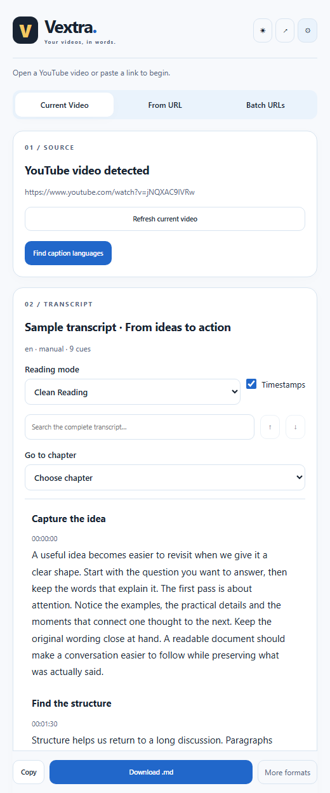
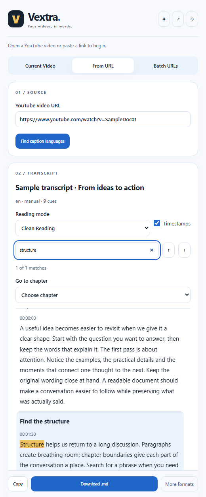
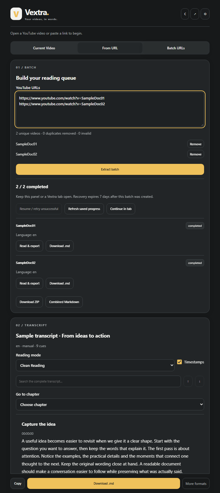
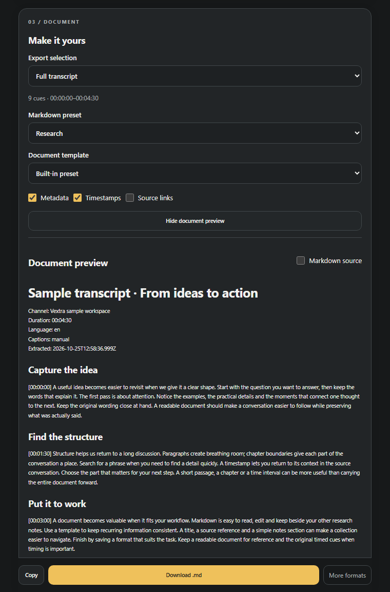
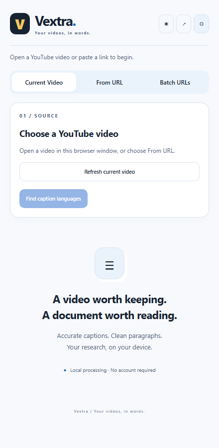
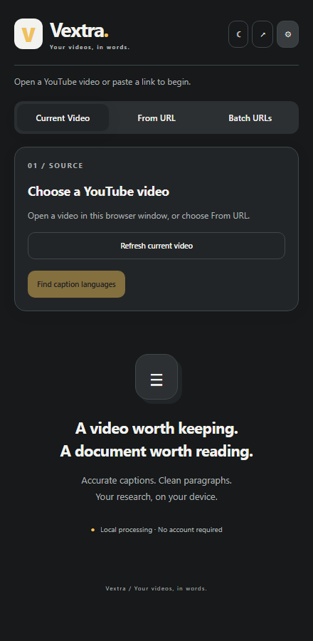
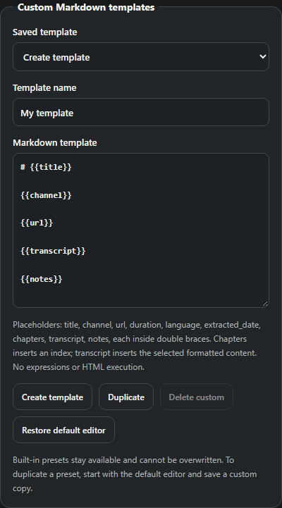

# Vextra

**Your videos, in words.**

[](LICENSE)
[](https://github.com/ezequiel-gb/vextra/releases)

Vextra is an open-source Chromium browser extension for extracting, reading and exporting YouTube transcripts. Work with available captions as searchable text and structured documents, including Markdown, in a side panel designed for research and reference.

**[Download Vextra v1.0.0](https://github.com/ezequiel-gb/vextra/releases/download/v1.0.0/Vextra-1.0.0-chromium.zip)** · [Releases](https://github.com/ezequiel-gb/vextra/releases) · [Installation](#installation)

## Features

- **Two source modes:** Current Video and From URL, with caption-language and caption-type selection.
- **A focused reader:** original captions or clean paragraphs, full-document search, timestamp links and available chapters.
- **Markdown documents:** Clean Reading, Research and Archive presets, metadata, optional timestamp references and custom templates.
- **More export formats:** TXT, SRT, VTT and versioned JSON, plus copying and browser-managed downloads.
- **Selective export:** the full transcript, time ranges, genuine chapters or selected passages.
- **Batch workflows:** URL validation, duplicate removal, per-video results, retry, cancellation, recoverable queues and ZIP or combined Markdown export.
- **Two considered themes:** white and light blue, or ash grey and charcoal, with a system-preference option.
- **Local processing:** preferences, formatting and temporary recovery data stay in the extension's browser profile.

### Working with YouTube captions

Vextra works with caption data made available by YouTube. When a track is missing, restricted or returns an empty response, the extension explains the issue and preserves your existing documents. Current Video can also use YouTube's native transcript panel. See [caption availability and compatibility](docs/LIMITATIONS.md).

## Screenshots

Explore the source modes, transcript reader and Markdown workspace. These captures show the running extension with clearly labelled sample documents.

### Current Video and From URL

| Current Video                                                                                                                                           | From URL                                                                                                                      |
| ------------------------------------------------------------------------------------------------------------------------------------------------------- | ----------------------------------------------------------------------------------------------------------------------------- |
|  |  |

### Batch URLs and Markdown export

| Batch URLs                                                                                                                                                | Markdown export                                                                                                             |
| --------------------------------------------------------------------------------------------------------------------------------------------------------- | --------------------------------------------------------------------------------------------------------------------------- |
|  |  |

<details>
<summary>Light and ash-grey dark themes</summary>

| Light                                                                                       | Ash-grey dark                                                                                      |
| ------------------------------------------------------------------------------------------- | -------------------------------------------------------------------------------------------------- |
|  |  |

</details>

<details>
<summary>Markdown template editor</summary>



</details>

## Installation

Download **[Vextra-1.0.0-chromium.zip](https://github.com/ezequiel-gb/vextra/releases/download/v1.0.0/Vextra-1.0.0-chromium.zip)** from [GitHub Releases](https://github.com/ezequiel-gb/vextra/releases).

Extract the ZIP into a permanent folder before installing. Select the extracted folder containing <code>manifest.json</code> directly, and keep it available afterward. GitHub's automatic **Source code** archives are for development; use the named Chromium release asset for installation.

### Brave

1. Open [GitHub Releases](https://github.com/ezequiel-gb/vextra/releases).
2. Download <code>Vextra-1.0.0-chromium.zip</code>.
3. Extract it into a permanent folder on your computer.
4. Open Brave.
5. Enter <code>brave://extensions</code> in the address bar.
6. Enable **Developer mode**.
7. Click **Load unpacked**.
8. Select the extracted folder containing <code>manifest.json</code>.
9. Confirm that Vextra appears in the extensions list.
10. Open the Extensions menu and pin Vextra if desired.
11. Open a YouTube video and click Vextra's toolbar icon.

### Google Chrome

1. Download the Chromium ZIP from [GitHub Releases](https://github.com/ezequiel-gb/vextra/releases).
2. Extract it into a permanent folder.
3. Open Chrome.
4. Enter <code>chrome://extensions</code> in the address bar.
5. Enable **Developer mode**.
6. Click **Load unpacked**.
7. Select the extracted folder containing <code>manifest.json</code>.
8. Confirm that Vextra appears in the extensions list.
9. Pin Vextra from the Extensions menu if desired.
10. Open a YouTube video and launch Vextra.

### Microsoft Edge

1. Download the Chromium ZIP from [GitHub Releases](https://github.com/ezequiel-gb/vextra/releases).
2. Extract it into a permanent folder.
3. Open Edge.
4. Enter <code>edge://extensions</code> in the address bar.
5. Enable **Developer mode**.
6. Click **Load unpacked**.
7. Select the extracted folder containing <code>manifest.json</code>.
8. Confirm that Vextra appears in the extensions list.
9. Pin Vextra from the Extensions menu if desired.
10. Open a YouTube video and launch Vextra.

Other compatible Chromium browsers use a similar extension-management interface. If a browser cannot support the side-panel manifest, use the [tab fallback ZIP](https://github.com/ezequiel-gb/vextra/releases/download/v1.0.0/Vextra-1.0.0-chromium-tab.zip). See [installation details](docs/INSTALLATION.md) for compatibility notes.

### Updating manually

Download and extract the newer release. Replace the files in your existing permanent extension folder, open your browser's extensions manager and click **Reload** on Vextra. Refresh open YouTube pages and reopen Vextra. Keep any documents you want as downloaded files before updating.

## How to use

### Extract from the current video

Open a YouTube video and launch Vextra's side panel. Choose **Current Video**, then **Find caption languages**. Select an available language and click **Extract Transcript**. An empty direct response triggers an attempt to open YouTube's native transcript controls automatically. Inaccessible captions produce a clear error.

### Extract from a URL

Choose **From URL**, paste a supported YouTube link and find its caption languages. Select a track and extract. Standard watch links, short-host links, mobile links, Shorts and live-video URL forms are recognized. This mode uses public caption acquisition without automatically opening a source tab.

### Read and search

Switch between **Original captions** and **Clean Reading**. Show or hide timestamps, search the complete transcript and move between matches. Timestamp links open the source video at the corresponding position. Genuine chapter metadata appears when available. Long transcripts use a bounded, paged reading window.

### Export

Choose a selection and Markdown preset, preview the document, then use **Copy**, **Download .md** or **More formats**. The primary download format can be changed in settings. SRT and VTT preserve original caption timing rather than reading paragraphs. See [the user guide](docs/USER-GUIDE.md) for time-range and passage-selection behavior.

### Process a batch

Choose **Batch URLs** and paste multiple links. Review invalid links, duplicates and the queue before starting. Keep Vextra's panel or an expanded Vextra tab open while processing. Completed items can be read or downloaded individually, combined as Markdown or saved in a ZIP. Failed items retain their own errors and can be retried. An interrupted queue can be resumed.

### Clear temporary transcripts

Open **Settings → Privacy and data → Clear temporary transcripts**. Preferences, custom templates and downloaded files are retained.

## Markdown export

Markdown is Vextra's main document format. Presets can include the video title, available metadata, source links, readable paragraphs, real chapter headings and optional timestamp references. Custom templates use a small, deterministic set of placeholders, including <code>{{title}}</code>, <code>{{channel}}</code>, <code>{{url}}</code> and <code>{{transcript}}</code>.

The following is an illustrative document structure:

```markdown
# Video title

Channel: Channel name
Language: en

[Source video](https://www.youtube.com/watch?v=VIDEO_ID)

## Available chapter heading

[00:02:15](https://www.youtube.com/watch?v=VIDEO_ID&t=135)
Transcript text from the selected caption cues appears here.

## Notes
```

Templates change presentation without summarizing or rewriting the speaker's words. Missing metadata is omitted. See [templates and export options](docs/USER-GUIDE.md#templates-and-settings) and the [JSON schema](docs/JSON-SCHEMA.md).

## Privacy

Vextra requires no Vextra account, subscription, paid API, separate processing server or mandatory AI service. Caption formatting, search and export happen locally. The extension communicates with YouTube to obtain video and caption information, and may load thumbnails from YouTube's image host.

Preferences are stored locally; temporary transcripts and batches have retention limits and can be cleared. There is no application telemetry or advertising. YouTube's own access requirements and behavior still apply. Read [the privacy document](docs/PRIVACY.md) for permissions and retention details.

## Development

Use Node.js **24.22.0** and npm. Dependencies are pinned in <code>package-lock.json</code>.

```sh
git clone https://github.com/ezequiel-gb/vextra.git
cd vextra
npm ci
npm run typecheck
npm run lint
npm test
npm run test:integration
npm run build
npm run validate:package
```

Development uses a **build-and-reload workflow**: run <code>npm run build</code>, load <code>dist/chromium-panel</code> as an unpacked extension, and reload it after rebuilding. The installed extension needs no development server. Its manifest is generated by <code>scripts/build.mjs</code>.

For isolated browser checks:

```sh
npx playwright install chromium
npm run test:browser -- --fixtures
```

On Windows with Edge installed, add <code>--edge</code>. The browser suite covers document workflows; live caption probes are available through <code>npm run test:live</code> and <code>npm run test:browser -- --live</code>.

Create release archives with <code>npm run package</code>. See [architecture](docs/ARCHITECTURE.md), [validation](docs/VALIDATION.md) and [contributor setup](CONTRIBUTING.md).

## Contributing

Bug reports, compatibility observations and pull requests are welcome. Read [CONTRIBUTING.md](CONTRIBUTING.md) before submitting a change. Report vulnerabilities privately using [SECURITY.md](SECURITY.md).

## Licence

Vextra is released under the [MIT Licence](LICENSE). Dependency licences and notices are preserved in [THIRD-PARTY-NOTICES.md](THIRD-PARTY-NOTICES.md).
